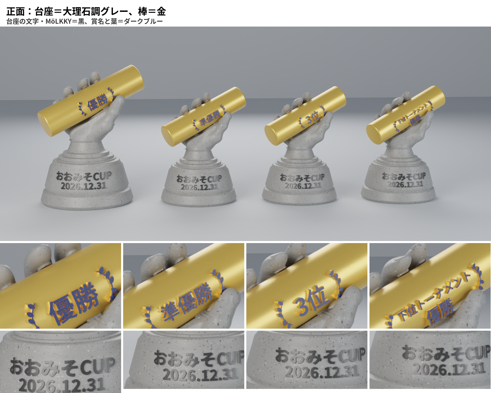

# モルックトロフィー（おおみそCUP / 横浜鶴見モルック会）

手が棒を握るデザインのトロフィーです。部品は「台座」（手と台座が一体）と「棒」の2つで、棒は差し込み式なので取り外しできます。

- 種類：優勝・準優勝・3位・下位トーナメント優勝の4種
- 優勝だけ、台座と棒の両方が通常サイズの1.2倍
- 想定プリンター：FlashForge Adventurer 5M（PETG）

## 印刷データ（`stl/`）

| ファイル | 使うトロフィー | サイズ |
|---|---|---|
| 台座_通常サイズ_準優勝・3位・下位トーナメント優勝用.stl | 準優勝・3位・下位トーナメント優勝（3個印刷） | 84.2 × 84.2 × 高さ120.0 mm |
| 台座_優勝_1.2倍.stl | 優勝 | 101.0 × 101.0 × 高さ144.0 mm |
| 棒_優勝_1.2倍_正面賞名_背面MöLKKY彫込_括弧葉.stl | 優勝 | 直径30.4 × 長さ117.5 mm |
| 棒_準優勝_正面賞名_背面MöLKKY彫込_括弧葉.stl | 準優勝 | 直径25.3 × 長さ97.9 mm |
| 棒_3位_正面賞名_背面MöLKKY彫込_括弧葉.stl | 3位 | 直径25.3 × 長さ97.9 mm |
| 棒_下位トーナメント優勝_正面賞名_背面MöLKKY彫込_括弧葉.stl | 下位トーナメント優勝 | 直径25.3 × 長さ97.9 mm |

- STLはどれも閉じた一体のデータで、印刷する向きで配置済みです。台座は底面を下、棒は立てた向きです。
- **棒の文字**
  - 正面：賞名（優勝／準優勝／3位／下位トーナメント・優勝の2段）を棒の長さの中央に、浮き彫りで入れています。両脇は（）形の葉の飾りです。
  - 背面：「MöLKKY」を深さ約0.9 mmで彫り込んでいます（優勝は約1.1 mm）。
- **台座の文字**
  - 正面：「おおみそCUP」「2026.12.31」
  - 背面：「横浜鶴見モルック会」
  - どちらも、台座に一周巻いた帯の上に約1 mmの浮き彫りで入れています（優勝は約1.2 mm）。
- 手の指や親指の内側はオーバーハングになるので、サポートを付けて印刷してください。棒が通る穴の中のサポートは、きれいに取り除いてください。

## 組み立て

1. 賞名を正面に向けます。
2. 正面から見て左側（小指側）から棒を差し込み、賞名が手の中央に来るまで押し込みます。
3. 外すときは左へ引き抜きます。

手の内側には、賞名と葉が通るための溝があります。賞名を正面に向けたまま差し込めば、文字は手に当たりません。逆向きや右側からは入りません。

棒と手のすき間は通常サイズで0.4 mm、優勝で0.48 mmです。手のひら内側にある細い突起2本で、軽く押さえる程度に保持します。きつい場合は、突起を軽くヤスリがけしてください。

## 着色

- 文字は油性のペイントマーカーで着色する想定です。抜き差しで手が触れる棒には、仕上げにクリアのトップコートを吹くと剥がれにくくなります。
- 彫り込みの「MöLKKY」は、溝にマーカーを流し込むように塗ります。はみ出した分は、乾いてから表面を軽く拭くか、ヤスリで落とすときれいに仕上がります。

## テストプリント（`test_print_1-3scale/`）

通常サイズの台座と下位トーナメント優勝の棒を、1/3スケールにしたテスト用データです。

| ファイル | サイズ |
|---|---|
| 台座_1-3スケール_テスト.stl | 28.1 × 28.1 × 高さ40.0 mm |
| 棒_下位トーナメント優勝_1-3スケール_テスト.stl | 直径8.4 × 長さ32.6 mm |
| プレビュー_1-3スケール_正面背面.png | 組み立てた状態のプレビュー |

- 形は上の正式版をそのまま1/3にしています。
- 次の寸法は実寸のまま残しているので、差し込みのきつさを本番に近い感覚で確認できます。
  - 棒と手のすき間：0.4 mm
  - 賞名と葉が通る溝の余裕：0.45 mm
  - 手のひら内側の押さえの突起（2本）
- 文字も1/3（浮き彫りは最大約1.2 mm、MöLKKYの彫り込みは約0.3 mm）なので、小さい文字は潰れます。形・サポート・はめ合いの確認用です。

## 画像（`images/`）

| ファイル | 内容 |
|---|---|
| イメージ図_正面_大理石調台座_金の棒.png / イメージ図_背面_大理石調台座_金の棒.png | 台座＝大理石調グレー、棒＝金 |
| イメージ図_正面_金の台座_大理石調の棒.png / イメージ図_背面_金の台座_大理石調の棒.png | 台座＝金、棒＝大理石調グレー |
| イメージ図_棒4種_正面背面.png | 棒4種の正面（賞名）と背面（MöLKKY） |
| 配色検討_旧デザイン/ | 配色を検討したときの画像（棒と台座の文字が前の版です） |

イメージ図の文字色は、台座の文字と「MöLKKY」が黒、賞名と葉がダークブルーです。

## 変更履歴

- 2026-10-27
  - 棒：正面の「MöLKKY」を削除し、賞名を棒の中央へ移動して（）形の葉の飾りを追加。背面の「MöLKKY」は彫り込みに変更。
  - 台座：1/3スケールのデータを3倍（優勝は3.6倍）に拡大して作成。文字を正面「おおみそCUP／2026.12.31」、背面「横浜鶴見モルック会」に変更。新しい賞名と葉が通るよう、手の内側の溝を追加。
  - 1/3テストプリント用データ（台座・下位トーナメント優勝の棒）を追加。
