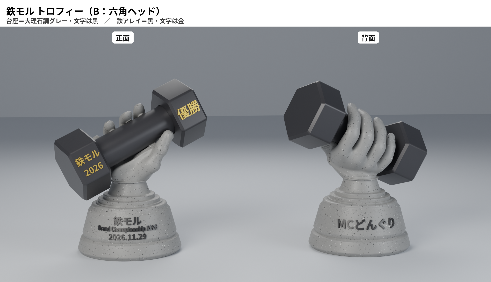
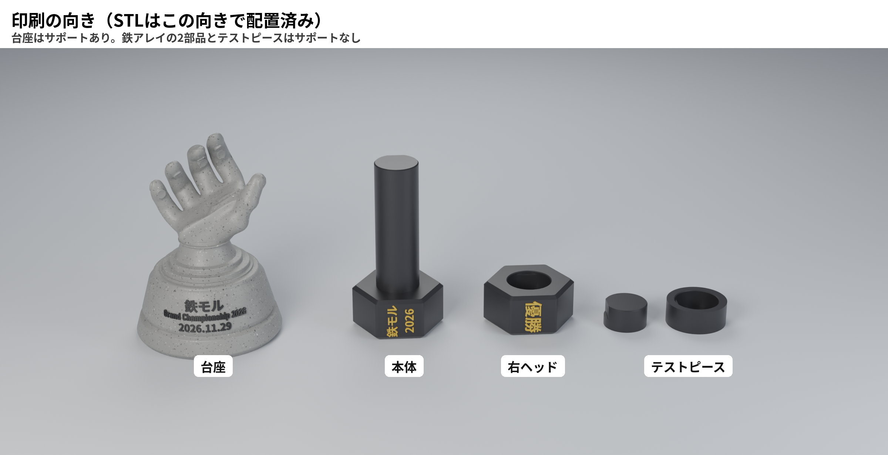
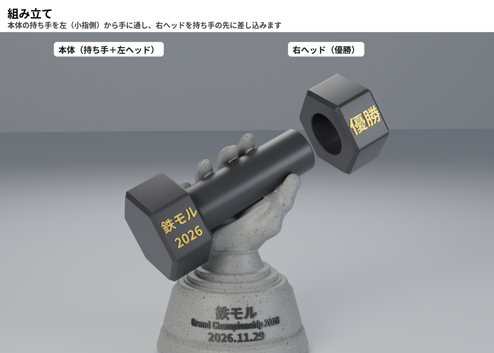

# 鉄モル トロフィー（Grand Championship 2026 / MCどんぐり）

おおみそCUPのトロフィーの台座（手と台座が一体）を使い、手に握らせるものをモルック棒から鉄アレイ（六角ヘッド）に変えた優勝トロフィーです。

- 台座：おおみそCUPの最新データ（2026-10-30版）。手・溝・押さえの突起はそのままで、文字だけ変えています。
- 大きさ：おおみそCUPの優勝と同じ1.2倍サイズ（台座の高さ144 mm）。組み立てると鉄アレイの右ヘッドが手より上に出るので、全体の高さは約167 mmです。
- 想定プリンター：FlashForge Adventurer 5M（PETG）

## 印刷データ（`stl/`）

| ファイル | 内容 | サイズ | サポート |
|---|---|---|---|
| 台座_鉄モル_優勝1.2倍.stl | 台座（手と台座が一体） | 101.0 × 101.0 × 高さ144.0 mm | あり（手の指・親指の内側） |
| 鉄アレイ_本体_持ち手と左ヘッド（鉄モル2026）_優勝1.2倍.stl | 持ち手と左ヘッドが一体 | 57.1 × 63.9 × 高さ121.2 mm | なし |
| 鉄アレイ_右ヘッド（優勝）_優勝1.2倍.stl | 右ヘッド（差し込み穴つき） | 57.1 × 63.9 × 高さ30.0 mm | なし |
| テスト_持ち手の先端_優勝1.2倍.stl | はめ合い確認用：持ち手の先端 | 直径30.4 × 高さ16.8 mm | なし |
| テスト_右ヘッドの差し込み穴_優勝1.2倍.stl | はめ合い確認用：右ヘッドの差し込み穴 | 直径42.4 × 高さ16.8 mm | なし |

- STLはどれも閉じたデータで、印刷する向きで配置済みです。
  - 本体：左ヘッドの端面を下にして立てる
  - 右ヘッド：外側の端面を下にして、差し込み穴を上に向ける
- **文字**
  - 台座の正面：「鉄モル」「Grand Championship 2026」「2026.11.29」の3行
  - 台座の背面：「MCどんぐり」
  - 台座の文字は、帯の上に約1.2 mmの浮き彫りです。
  - 鉄アレイ：左ヘッドの正面に「鉄モル／2026」（2行、約24 × 19 mm）、右ヘッドの正面に「優勝」（約24 × 11 mm）。どちらも約1 mmの浮き彫りです。
- 台座の手の指や親指の内側はオーバーハングになるので、サポートを付けて印刷してください。持ち手が通る穴の中のサポートは、きれいに取り除いてください。

## 組み立て

1. 本体の持ち手を、正面から見て左側（小指側）から手に通します。
2. 手の右側に出た持ち手の先に、右ヘッドを差し込みます。
   - 持ち手の先（12 mm）の背面側に平らな面があり、右ヘッドの穴にも同じ平らな面があります。向きが合ったときだけ入るので、「優勝」と「鉄モル／2026」が同じ側にそろいます。
3. 鉄アレイを回して、文字を正面に向けます。

外すときは、右ヘッドを抜いてから本体を左へ引き抜きます。

- 持ち手は、おおみそCUPの優勝のモルック棒と同じ太さ（直径30.4 mm）です。手とのすき間は0.48 mmで、手のひら内側にある細い突起2本で軽く押さえます。おおみそCUPの優勝のモルック棒も、この台座にそのまま差せます。
- 右ヘッドの穴と持ち手の先のすき間は、半径で0.15 mmです（1.2倍にしてもこの値のままです）。

## テストピース

本番の前にテストピース2個（小さいので短時間で印刷できます）を印刷し、持ち手の先を穴に差して、はめ合いを確かめてください。

- きつい場合：持ち手の先を軽くヤスリがけしてください。
- ゆるい場合：マスキングテープを薄く1周巻くか、接着剤で固定してください。接着すると、台座から外せなくなります。

## 着色

文字は油性のペイントマーカーで着色する想定です（イメージ図では、台座の文字が黒、鉄アレイの文字が金）。手で触れる鉄アレイには、仕上げにクリアのトップコートを吹くと剥がれにくくなります。
